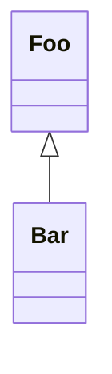

# runtime

[](https://github.com/flowscripter/runtime/releases)
[](https://github.com/flowscripter/runtime/actions/workflows/release-bun-library.yml)
[](https://codecov.io/gh/flowscripter/runtime)
[](https://flowscripter.github.io/runtime/index.html)
[](https://github.com/flowscripter/runtime/blob/main/LICENSE)

> Flowscripter runtime library

> Work in progress.

## Bun Module Usage

Add the module:

`bun add @flowscripter/runtime`

Use the module:

```typescript
import { world } from "@flowscripter/runtime";

world();
```

## Development

Install dependencies:

`bun install`

Build (produces `dist/` for Node.js and TypeScript consumers; Bun uses raw source directly):

`bun run build`

Test:

`bun test`

Format:

`bunx oxfmt`

Lint:

`bunx oxlint index.ts src/ tests/`

Generate HTML API Documentation:

`bunx typedoc index.ts`

## Documentation

### Overview

Sample mermaid diagram to test rendering in markdown:



### API

Link to auto-generated API docs:

[API Documentation](https://flowscripter.github.io/runtime/index.html)

## License

MIT © Flowscripter
